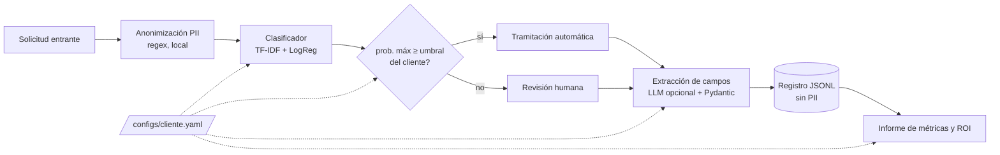
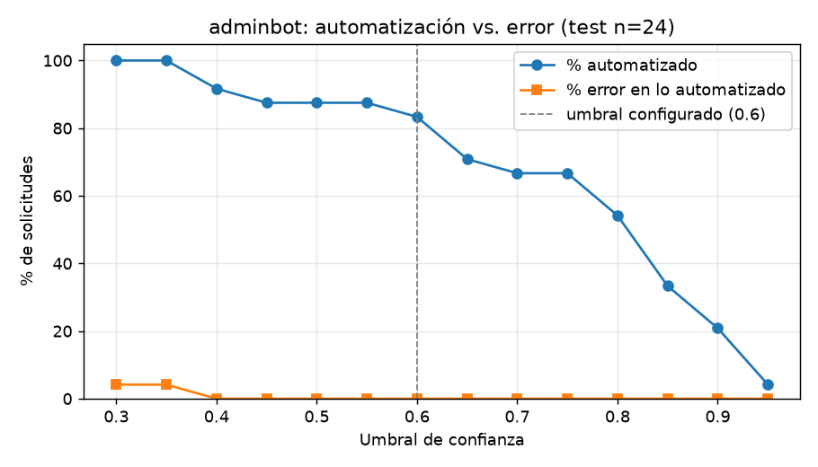
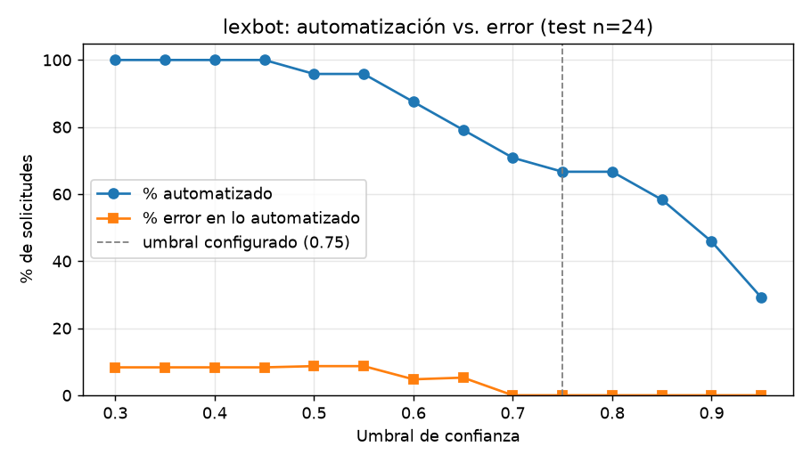

# Motor de triaje de solicitudes — Iberianbots

Prototipo del **núcleo común** de los bots de Iberianbots (LexBot, AdminBot, MediFlow): recibe una
solicitud en texto libre, **anonimiza los datos personales en local**, la **clasifica**, decide si se
tramita **automáticamente o pasa a revisión humana**, extrae campos (opcional, con LLM) y **mide el
ahorro**. Dar de alta un cliente nuevo es escribir un fichero YAML, no desarrollar.

## 1. Problema

Cada bot a medida empieza resolviendo lo mismo: "¿qué me están pidiendo y a quién se lo paso?". Si ese
triaje se rehace en cada proyecto, cada entrega es lenta y cada bot es distinto de mantener. Este motor
ataca las tres promesas comerciales de Iberianbots:

| Promesa | Cómo la sostiene el motor |
|---|---|
| **Integración sencilla** | Un cliente = un YAML (categorías, campos, umbral). El código no cambia entre AdminBot y LexBot. |
| **Cumplimiento RGPD** | La PII se enmascara en local *antes* de entrenar, clasificar, registrar o llamar a un LLM. |
| **Resultados medibles desde el primer mes** | Cada evaluación produce % automatizado, error en lo automatizado y horas ahorradas por cada 1.000 solicitudes. |

## 2. Arquitectura



```
configs/        adminbot.yaml, lexbot.yaml   ← todo lo específico de cada cliente
data/           generate_synthetic.py        ← ~120 solicitudes sintéticas por cliente
triage/         anonymizer · classifier · router · extractor · engine
scripts/        train_eval.py                ← entrenamiento, evaluación, curva y ROI
reports/        <cliente>_eval.md, _curva.png, _metrics.json
app.py          demo Streamlit
tests/          anonimizador y motor
```

Uso desde código:

```python
from triage import TriageEngine

motor = TriageEngine.from_config("configs/adminbot.yaml")
motor.procesar("Quiero empadronarme, mi DNI es 12345678Z")
# {'texto_anonimizado': 'Quiero empadronarme, mi DNI es [DNI]', 'categoria': 'empadronamiento',
#  'confianza': 0.93, 'ruta': 'auto', 'entidades_pii': {'DNI': 1}, ...}
```

## 3. Cómo ejecutarlo (3 comandos)

Requiere Python 3.13 y `make`.

```bash
make setup              # entorno virtual + dependencias
make data train eval    # datos sintéticos, modelos e informes en reports/
make app                # demo en http://localhost:8501
```

`make test` ejecuta los tests. La extracción de campos con LLM es opcional: se activa si existe
`ANTHROPIC_API_KEY` (o `OPENAI_API_KEY`, con `pip install openai`); sin clave, la demo muestra un aviso
y el resto del flujo funciona igual.

## 4. Resultados

Resultados reales de `make data train eval` (semilla fija, split 80/20 estratificado: 96 de
entrenamiento y 24 de test por cliente). Informes completos con classification report y matriz de
confusión en [reports/adminbot_eval.md](reports/adminbot_eval.md) y
[reports/lexbot_eval.md](reports/lexbot_eval.md).

| Cliente | Categorías | Accuracy | Macro-F1 | Umbral | % automatizado | % error en lo automatizado | Min. manuales/doc | Horas ahorradas / 1.000 solicitudes |
|---|---|---|---|---|---|---|---|---|
| AdminBot | 5 | 0,958 | 0,960 | 0,60 | 83,3 % | 0,0 % | 6 | **83 h** |
| LexBot | 4 | 0,917 | 0,916 | 0,75 | 66,7 % | 0,0 % | 9 | **100 h** |

ROI = docs automatizados × minutos manuales / 60. Ejemplo LexBot: 1.000 × 0,667 × 9 / 60 = 100 h.

Estos números son sobre **24 solicitudes sintéticas de test por cliente**: cada solicitud pesa 4,2
puntos porcentuales, así que "0,0 % de error" significa "0 fallos en 16–20 casos", no una garantía.
Sirven para demostrar que el flujo y la medición funcionan, no para prometer cifras a un cliente.

| AdminBot | LexBot |
|---|---|
|  |  |

La curva es la herramienta de negociación con el cliente: mover el umbral cambia cuánto se automatiza
y cuánto error se acepta. En LexBot, con umbral 0,60 se automatizaría el 87,5 % con un 4,8 % de error;
con 0,75 se automatiza el 66,7 % sin errores en test.

## 5. Decisiones técnicas

**ADR-1 · Anonimizar en local antes de cualquier LLM**
- *Contexto:* las solicitudes traen DNI, teléfonos, IBAN; los clientes son despachos, ayuntamientos y clínicas.
- *Decisión:* regex locales sustituyen la PII por etiquetas (`[DNI]`, `[IBAN]`…) como primer paso; el clasificador, el LLM y el registro solo ven texto anonimizado.
- *Consecuencia:* minimización de datos por diseño y sin dependencias pesadas; a cambio, las regex no detectan nombres ni direcciones (ver limitaciones).

**ADR-2 · Baseline clásico antes que LLM**
- *Contexto:* el triaje se ejecuta en cada solicitud; importa el coste, la latencia y poder explicar la decisión.
- *Decisión:* TF-IDF (palabras + n-gramas de caracteres, robustos a faltas de ortografía) + regresión logística.
- *Consecuencia:* entrena en segundos en un portátil, inferencia en milisegundos, coste por solicitud ≈ 0 y pesos inspeccionables. El LLM queda para donde aporta: extracción de campos y, más adelante, los casos dudosos.

**ADR-3 · Enrutado por confianza con humano en el bucle**
- *Contexto:* un error de clasificación en un recurso legal o una ayuda social tiene coste real.
- *Decisión:* solo se automatiza si la probabilidad máxima supera el umbral del cliente; el resto va a revisión humana con la segunda categoría como pista.
- *Consecuencia:* el riesgo es un parámetro de negocio explícito (LexBot 0,75, AdminBot 0,60) y la curva automatización/error lo hace negociable.

**ADR-4 · Configuración por YAML para multi-cliente**
- *Contexto:* el objetivo es acortar la entrega de cada bot nuevo.
- *Decisión:* categorías, campos a extraer, umbral, minutos manuales y ejemplos de la demo viven en `configs/<cliente>.yaml`; el motor no contiene nada específico de un cliente.
- *Consecuencia:* alta de cliente = YAML + datos etiquetados + `make train eval`. La demo descubre los clientes listando `configs/`.

**ADR-5 · Datos sintéticos**
- *Contexto:* no hay datos reales y no deberían usarse sin base legal.
- *Decisión:* generador con plantillas, semilla fija, faltas de ortografía, tono informal, ~15 % de casos ambiguos y PII inventada.
- *Consecuencia:* reproducible y sin riesgo de privacidad, pero optimista respecto a datos reales.

## 6. Limitaciones

- **Datos sintéticos y pocos.** 7 frases base por categoría combinadas con ruido: train y test comparten plantillas, así que las métricas sobrestiman el rendimiento real. Con 24 ejemplos de test los intervalos de confianza son muy anchos.
- **El umbral de LexBot se eligió mirando la curva de test** (0,60 → 0,75). En un proyecto real se fijaría con un conjunto de validación separado.
- **Regex frente a NER.** Se detectan DNI, NIE, teléfono, email e IBAN por formato. **No** se detectan nombres, direcciones, fechas de nacimiento ni datos de salud, que siguen en el texto que vería el LLM. No se valida la letra del DNI ni el dígito de control del IBAN.
- **Probabilidades sin calibrar.** El enrutado trata la salida de la regresión logística como probabilidad real; sin calibración, un 0,75 no significa "acierta el 75 % de las veces".
- **Extracción con LLM no ejercitada en esta entrega.** El camino sin clave está cubierto por tests; la llamada real (Anthropic/OpenAI) no se ha podido ejecutar por no disponer de clave en el entorno de desarrollo.
- **Una etiqueta por solicitud.** Los casos que mezclan dos trámites se etiquetan con el principal; no hay clasificación multi-etiqueta ni detección de solicitudes fuera de catálogo.
- **ROI simplificado.** Supone que cada documento automatizado ahorra todo el tiempo manual y no descuenta el coste de los errores ni de la revisión.

## 7. Siguientes pasos

1. **NER local para PII** (nombres, direcciones, datos de salud) con un modelo ligero ejecutado on-premise, manteniendo las regex para identificadores con formato.
2. **Calibración de probabilidades** (Platt/isotónica) y elección de umbral en validación, con objetivo de error máximo por cliente.
3. **Cascada baseline → LLM solo en casos dudosos:** lo que hoy va a revisión humana pasa antes por un LLM; solo se escala a persona si tampoco hay confianza.
4. **Feedback loop:** las correcciones del revisor humano se guardan como etiquetas y alimentan reentrenamientos periódicos.
5. **RAG sobre normativa** (ordenanzas, legislación, protocolos) para proponer borradores de respuesta al tramitador.
6. **Conectores a CRM/ERP** y gestores de expedientes para abrir el trámite en el sistema del cliente.
7. **Observabilidad:** tasa de automatización, deriva de datos y de confianza, y auditoría de decisiones a partir del registro JSONL.
8. **Despliegue en contenedor** con API REST (FastAPI) y un modelo versionado por cliente.
